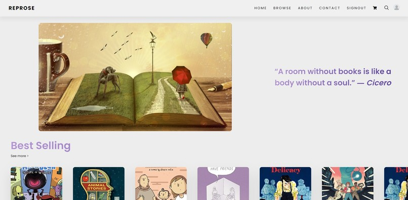

# ReProse | Book exchange prototype

ReProse is an early Django prototype for students to list and find books to lend, borrow, or sell. The repository preserves the original demo; it is not a running marketplace or a verified payment service.

[](https://www.youtube.com/watch?v=YH49sNHiUj8&t=48s)

## What the prototype shows

- Browsing and adding book listings.
- Account and profile screens with a personal listings view.
- A cart and checkout interface. Their presence does not mean that payments or deposits are ready to use.

[Routes](book_library/bookapp/urls.py) and [models](book_library/bookapp/models.py) are good starting points for reviewing the implementation. The app uses Django, Python, SQLite, HTML/CSS, and JavaScript.

## Local development status

The Django entry point is [`book_library/manage.py`](book_library/manage.py). The original demo used Python 3.11. A fresh checkout does not include a pinned dependency manifest, so a first-time setup is not reproducible from this repository alone. For an existing development environment, inspect project configuration and check it before starting a local server:

```bash
cd book_library
python manage.py check
python manage.py runserver
```

Use a disposable local database and fictional entries. Do not use the demo for real orders, payments, or account data.

## Inspiration

Our journey began with a passion for literature and coding, coupled with the desire to make books more accessible to students and readers worldwide. We identified a need for an efficient, affordable, and scalable solution that simplifies book exchanges while bridging the digital divide in education.

## What's next?
Here are a few ideas that we would love to implement to take Reprose forward:

- **Chat Feature** – A built-in chat for seamless communication between users.

- **Secure Transactions** – Implementing a deposit system for borrowed books.

- **Expansion Beyond Books** – Facilitating the lending and borrowing of other items to encourage reuse of resources.

- **AI-Powered Book Recommendations** – Implementing generative AI to suggest books based on user reading habits and preferences.

- **Notes Generation Tool** – Using AI to generate notes of books to help students revise the contents of books before exams.

- **AI-Driven Price Optimization** – Leveraging machine learning to recommend fair pricing for used books based on market trends and book conditions.
